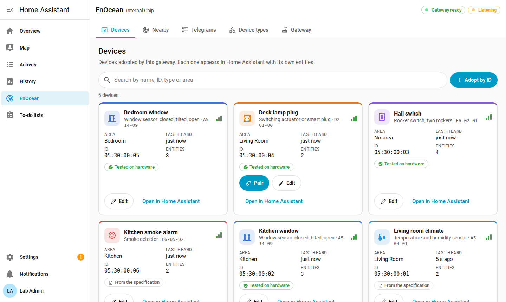
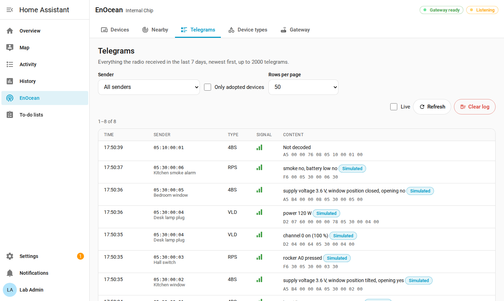
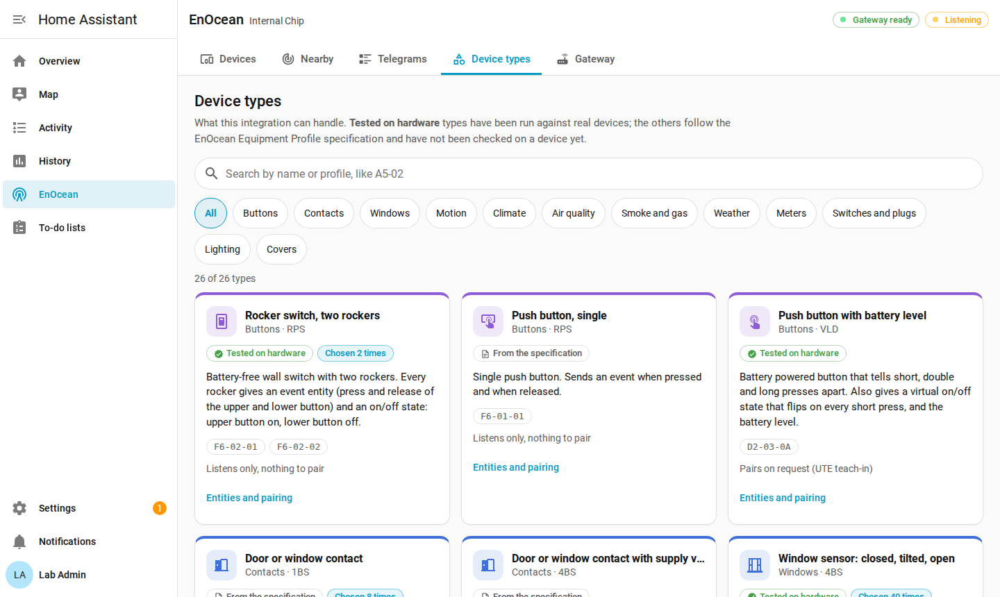
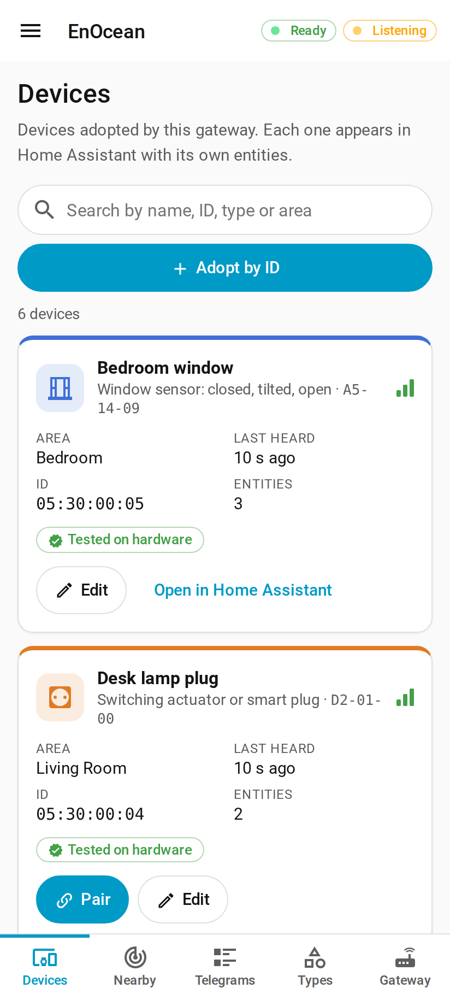

# EnOcean Internal Chip


A Home Assistant integration for EnOcean devices, through a USB stick or a
module built into the hub, as long as it speaks the ESP3 serial protocol.

Everything is set up from the user interface: the module, the devices, the
pairing. A panel in the sidebar shows what the radio hears, which devices are
adopted, the telegrams they send and the state of the gateway.



## Features

- **Set up from the UI.** The integration looks for ESP3 modules on the serial
  ports and offers the ones that answer. You can also type the port by hand.
- **A panel for administrators**, in the sidebar, with five tabs: Devices,
  Nearby, Telegrams, Device types and Gateway. It works on phones too, with a
  bottom navigation bar and sheets that slide up from the bottom.
- **Nearby transmitters.** While listening, every transmitter that has never
  been heard before joins a list, with its signal strength and what it sends.
  Adopt it with a click. **Mute** stops the teach-in notifications of a
  transmitter, **Forget** removes it from the list.
- **Pairing for two-way devices** (UTE teach-in): pairing opens for 3 minutes,
  and the gateway answers the device as soon as it asks. Devices you have
  adopted are always answered.
- **One sender address per one-way actuator.** Each actuator is taught with
  its own address, derived from the gateway address, so actuators can be
  paired and removed one at a time.
- **Switching actuators are checked.** After each command the integration
  waits for the actuator to report its new state, retries twice, and fires an
  event if no answer comes.
- **The gateway address is guarded.** The module allows only a few address
  changes in its whole life. Changes are locked by default, every change is
  recorded with the original address, and two changes are always kept in
  reserve.
- **Labels.** New entities can get a generic label by type (Lighting, Climate,
  Doors & windows, …) and by role (Perimeter, Interior, 24/7 safety).
- **Simulation.** Ready-made telegrams let you test automations without
  hardware. Off by default.
- **Diagnostics** that you can share: device IDs are replaced and the gateway
  address is left out.
- **Local only.** Nothing leaves your Home Assistant.

## Screenshots

| Telegrams | Device types | On a phone |
| --- | --- | --- |
|  |  |  |

## Requirements

- Home Assistant 2025.6 or newer. Developed and tested with 2026.2.3.
- An EnOcean module that speaks ESP3 on a serial port: a USB stick, or a
  module built into the board of the hub.
- One module per Home Assistant instance.

A serial port can be opened by one program at a time. If another integration
or add-on uses the same module, remove it from there first.

## Installation

### With HACS

1. In HACS, open the menu in the top right corner and choose **Custom
   repositories**.
2. Add `https://github.com/StevyOpen/enocean-internal-chip` with the type
   **Integration**.
3. Download **EnOcean Internal Chip** and restart Home Assistant.
4. Go to **Settings → Devices & services → Add integration** and choose
   **EnOcean Internal Chip**.

### By hand

1. Copy the folder `custom_components/enocean_internal_chip` of this
   repository into the `custom_components` folder of your Home Assistant
   configuration.
2. Restart Home Assistant.
3. Go to **Settings → Devices & services → Add integration** and choose
   **EnOcean Internal Chip**.

When the module is found, the **EnOcean** panel appears in the sidebar of
administrators.

## Adding devices

**Adopting** a device adds it to Home Assistant, with its entities.
**Pairing**, also called teach-in, lets an actuator obey the gateway: the
actuator must be in **learn mode**, which you usually start with a button on
the actuator itself.

### Devices that only transmit

Sensors, contacts, buttons and wall switches send telegrams and do not need
to be paired.

1. Open **EnOcean** in the sidebar, then the **Nearby** tab.
2. Choose **Listen for new devices**.
3. Press the button of the device, or wait for it to transmit.
4. Choose **Adopt** on its card, then give it a name, a type and an area.

If you already know the ID of the device (it is often printed on it), choose
**Adopt by ID** in the **Devices** tab instead of waiting for it to transmit.

### Two-way actuators

Switching actuators, smart plugs and blind actuators of the D2 family pair
with a UTE teach-in.

1. Adopt the actuator from **Nearby**, or with **Adopt by ID**.
2. Choose **Pair** on its card, or **Open pairing for 3 minutes** in the
   **Gateway** tab. The `open_pairing` action can keep it open from 10 to 600
   seconds.
3. Put the actuator into learn mode. The gateway answers as soon as the
   actuator asks.

Some actuators need a confirmation press on their own button after learn mode.
If an actuator keeps asking to pair, the panel says so.

### One-way actuators

Actuators that obey rocker telegrams (F6-02) or central commands (A5-38-08)
remember the address they were taught with.

1. Adopt the actuator from **Nearby**, or with **Adopt by ID**.
2. Put the actuator into learn mode.
3. Choose **Pair** on its card: the integration sends the teach-in from the
   address reserved for that actuator.

## Events

Buttons and switches become **event entities**:

| Device | Event types |
| --- | --- |
| Rocker switch | `press_0`, `release_0` (upper button), `press_i`, `release_i` (lower button), for each rocker |
| Single push button | `press`, `release` |
| Push button with battery level | `short_press`, `double_press`, `long_press`, `long_release` |

When a switching actuator does not confirm a command, even after two retries,
the integration fires `enocean_internal_chip_no_feedback` on the event bus,
with `entity_id`, `device_id`, `command` and `attempts`. For example:

```yaml
triggers:
  - trigger: event
    event_type: enocean_internal_chip_no_feedback
actions:
  - action: persistent_notification.create
    data:
      title: EnOcean actuator not answering
      message: "{{ trigger.event.data.entity_id }} did not confirm '{{ trigger.event.data.command }}'."
```

## Actions

| Action | What it does |
| --- | --- |
| `enocean_internal_chip.open_pairing` | Opens pairing for two-way devices. `seconds`: from 10 to 600, 180 by default. |
| `enocean_internal_chip.simulate` | Feeds a ready-made telegram to the integration, as if a device had sent it. `preset`: which telegram; `sender`: the device ID, optional. Needs the **Allow simulated telegrams** option. |

## Options

**Settings → Devices & services → EnOcean Internal Chip → Configure**

| Option | Default | What it does |
| --- | --- | --- |
| Label new entities by type | On | New entities get a label such as Doors & windows, Climate or Buttons. Entities that already have labels are left alone. |
| Also label entities by role | On | Doors and windows also get Perimeter, motion sensors Interior, smoke and CO alarms 24/7 safety. |
| Notify about new devices | On | Show a notification when a device that is not adopted yet sends a teach-in telegram. |
| Allow simulated telegrams | Off | Lets the panel and the simulate action inject test telegrams. |

To use another port, for example after moving the USB stick, choose
**Reconfigure** on the integration. Adopted devices stay as they are. A new
module has a different address: one-way actuators must then be paired again.

## The gateway address

The gateway transmits with an address of its own, the Base ID, which the
panel calls the gateway address. One-way
actuators remember the address they were taught with and obey any gateway
that transmits with it. Changing the address therefore changes which
actuators listen to this gateway.

The module allows only a small number of address changes in its whole life,
usually 10. For this reason the **Gateway** tab:

- keeps the changes locked until an administrator unlocks them;
- records the original address the first time it reads it, and every change
  after that, with date, old and new address, and a note;
- asks for the confirmation word `CONTINUE` after five changes made from this
  integration, or when the module does not say how many changes are left;
- always keeps the last two changes in reserve, to go back to the original
  address;
- can restore the original address.

## Supported device types

**Tested on hardware**: the profile has been run against real devices.
**From the specification**: the profile follows the EnOcean Equipment Profile
specification and has not been checked on a device yet. Reports are welcome
in the [issues](https://github.com/StevyOpen/enocean-internal-chip/issues).

| Device type | Profiles (EEP) | Pairing | Status |
| --- | --- | --- | --- |
| Rocker switch, two rockers | F6-02-01, F6-02-02 | None | Tested on hardware |
| Push button, single | F6-01-01 | None | From the specification |
| Push button with battery level | D2-03-0A | UTE | Tested on hardware |
| Door or window contact | D5-00-01 | None | From the specification |
| Door or window contact with supply voltage | A5-14-01 | None | From the specification |
| Window sensor: closed, tilted, open | A5-14-09 | None | Tested on hardware |
| Window sensor with vibration alarm | A5-14-0A | None | Tested on hardware |
| Window handle: closed, tilted, open | F6-10-00 | None | From the specification |
| Motion sensor | A5-07-01, A5-07-02, A5-07-03 | None | From the specification |
| Light, temperature and motion sensor | A5-08-01, A5-08-02, A5-08-03 | None | From the specification |
| Temperature sensor | All A5-02 profiles | None | From the specification |
| Temperature and humidity sensor | A5-04-01, A5-04-02, A5-04-03 | None | From the specification |
| Light sensor | A5-06-01, A5-06-02, A5-06-03 | None | From the specification |
| CO2 sensor | A5-09-04, A5-09-08, A5-09-09 | None | From the specification |
| Carbon monoxide sensor | A5-09-02 | None | From the specification |
| VOC sensor | A5-09-05 | None | From the specification |
| Smoke detector | F6-05-02 | None | From the specification |
| Weather station | A5-13-01 | None | From the specification |
| Electricity meter | A5-12-01 | None | From the specification |
| Gas meter | A5-12-02 | None | From the specification |
| Water meter | A5-12-03 | None | From the specification |
| Switching actuator or smart plug | D2-01-00 to D2-01-12 | UTE | Tested on hardware |
| Actuator controlled by rocker telegrams | F6-02-01 | Rocker teach-in | From the specification |
| Switching actuator, central command | A5-38-08 | 4BS teach-in | From the specification |
| Dimming actuator, central command | A5-38-08 | 4BS teach-in | From the specification |
| Roller shutter or blind actuator | D2-05-00 | UTE | Tested on hardware |

The **Device types** tab of the panel shows the same list, with the entities
that each type creates.

## Removing devices and the integration

Removing a device from the panel asks first, and says how many entities go
with it. You can also remove a device from its Home Assistant device page.

The list of adopted devices and the record of the gateway address are kept in
two files under `.storage` in your configuration folder:
`enocean_internal_chip.devices` and `enocean_internal_chip.gateway_address`.
They stay there when you remove the integration, so adding it again brings
your devices back. Delete the two files if you want to start from scratch.

## Security

- The panel and its API are for administrators only.
- Gateway address changes are locked by default, and need an unlock and a
  confirmation.
- Simulated telegrams are off by default.
- Diagnostics replace the device IDs and leave the gateway address out.
- The integration talks only to the serial port. It has no cloud part.

## Trying it without hardware

`scripts/fake_module.py` emulates an ESP3 module on a pseudo-terminal. It runs
on Linux and macOS, on the same machine as Home Assistant.

```sh
python3 scripts/fake_module.py --link /tmp/enocean-fake --demo
```

Give the integration the port `/tmp/enocean-fake`. With `--demo` a
thermometer, a window contact and a rocker switch transmit now and then. Type
the name of a preset, for example `window_open`, and press Enter to receive it
at once.

## Development

With Python 3.13:

```sh
python3 -m venv .venv
. .venv/bin/activate
pip install -r requirements_test.txt
pytest
ruff check . && ruff format --check .
```

The tests run the integration against an emulated module, and compare the
profile decoders with those of the `enocean` Python library.

## License

Apache License 2.0, see [LICENSE](LICENSE) and [NOTICE](NOTICE).

This project started from the EnOcean integration that ships with Home
Assistant, also under the Apache License 2.0, and has since been rewritten.

This is a custom integration: it is not part of Home Assistant and is not
endorsed by the Home Assistant project.

EnOcean is a registered trademark of EnOcean GmbH. This project is not
affiliated with, endorsed by or sponsored by EnOcean GmbH or the EnOcean
Alliance.
